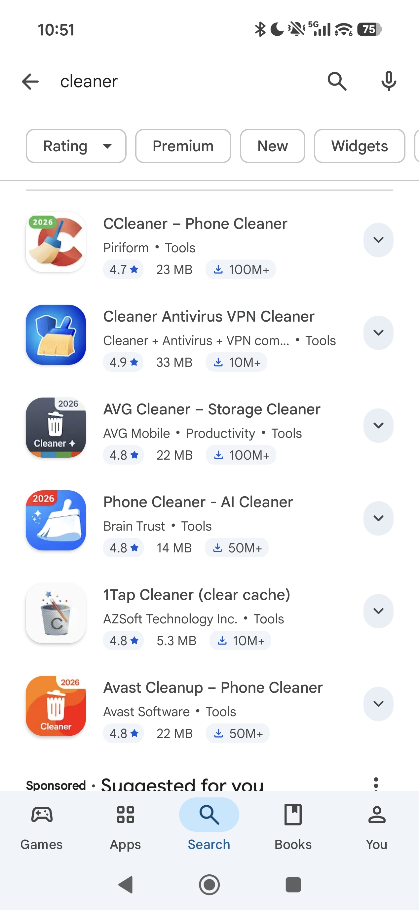

Um dos serviços que eu fiz algumas vezes como suporte técnico foi remover "vírus" de celulares Android. Só que pra quem não sabe, o Android dificulta muito você instalar aplicativos que são ***obviamente*** maliciosos no seu celular. Quando você sobe um aplicativo na Play Store, o algorítmo do Google checa pra ver se ele não faz nada além do que um App deve fazer. e, apesar dessa checagem não ser perfeita, ela já filtra boa parte dos malwares mais óbvios.

Só que não é só de roubar credenciais e brickar aparelhos que vivem os malwares, adversários estão cada dia se reinventando de se aproveitar de brechas em sistemas pra ganhar vantagens (geralmente monetária) a custo dos outros. e nesse post o assunto vão ser **aplicativos de limpeza**, ou "*Cleaners*", também apelido por quem vos fala de "apps vassourinha".

## O primeiro estágio: Prometer resolver um problema do usuário
Se você não faz parte dos 1% mais privilegiados, é bem possível que você já teve que lidar com um dispositivo lento. Falta de RAM, processador datado, armazenamento cheio, todas essas coisas geralmente são resolvidas comprando um aparelho mais novo, ou melhorando o que já tem (quando possível), padrões de uso e hábitos podem mitigar *alguns* desses aspectos, principalmente armazenamento, mas no geral, depois de alguns anos de atualizações, seu dispositivo vai ficar obsoleto. Em uma tentativa de dar uma sobrevida a esses dispositivos, uma pessoa pode se deparar com apps "cleaner", como esses:

Esse tipo de app faz promessas bem tentadoras como: Otimizar processos em segundo plano, liberar armazenamento, memória RAM, e até remover os tais "vírus". E tudo bem, pode ser que eles até façam tudo isso aí mesmo, esse não é o problema, o Android expõe quase todos esses mecanismos na API dele por meio das permissões, mas é exatamente aí nas permissões que vem o problema.

## Segundo estágio: Monetização
A maioria desses aplicativos são de graça, por que né? 2026? quem que paga por aplicativo de celular? A indústria condicionou as pessoas que pagar por algo no celular é execrável.

> "*Pra que vou pagar se tem esses outros 10 apps que fazem isso de graça?*"

O problema é que, como sempre:

> "*Se o produto é de graça, então o produto é você*"

Esses aplicativos usam anúncios pra monetizar o serviço, você paga com seu tempo e seus dados pra não precisar pagar de forma monetária, mas ok, você pode falar, corretamente:

> "*Mas isso é um tradeoff válido, Google tem o mesmo modelo de negócios e é uma das ferramentas mais importantes da tecnologia*"

Você está correto. mas esse modelo tamabém pode ser usado pra explorar a ingenuidade e o analfabetismo digital de muitas pessoas (principalmente os mais velhos), como? **Rodando em segundo plano**.

Imagina você, sendo uma pessoa que não entende muito de celulares, baixa uma "Vassourinha" dessas, e ele abre falando pra você coisas desse tipo:

> "*Para que o app funcione corretamente, nos dê permissão de rodar em segundo plano para otimizarmos seu dispositivo a qualquer momento*"

> "*Habilite as notificações para que nós lhe avisemos quando algo está errado com seu dispositivo*"

Tudo isso tem um fundo de verdade, mas não é pra isso que eles querem que você dê todas essas permissões. Na verdade elas servem pra que o app possa te mostrar anúncios mesmo quando está fechado. e geralmente são anúncios em tela cheia, que você precisa esperar 5-10 segundos pra fechar.

## Terceiro estágio: O loop infinito de anúncios
É aqui que o negócio fica engenhoso a um nível de pilantragem impressionante. Esses pop-ups de anúncio são providos pela Google, você, como dev, usa a API deles pra renderizara um anúncio relevante pro usuário que tá utilizando seu app. Agora pensa como funciona esses anúncios: O Google, por padrão, sabe todos os aplicativos que você baixa, todos os sites que você navega, e usa isso pra entender qual anúncio ele vai te recomendar. Quando você baixa uma "Vassourinha", pinga lá nos servidores do Google a seguinte informação:

> "*Opa, esse usuário se interessa por aplicativos de limpeza, vamos enviar conteúdo relevanta pra ele no próximo anúncio.*"

**BÔNUS:** Você pode ver o que o Google "sabe" sobre você no [Ad Center](https://myadcenter.google.com/).

Só que você já baixou uma "Vassourinha", pra que outro? Dane-se, isso não importa pro Google. O app que você baixou e deu (silenciosamente) permissões pra mostrar anúncios na home do seu celular vai te recomendar outra "Vassourinha", agora imagine-se novamente na pele de uma pessoa vulnerável digitalmente, você vai clicar no maior botão sem ler, achando que é o botão de fechar, porque essas pessoas não entendem que o botão de fechar anúncios, na verdade, fica escondido no canto da tela. Isso vai instalar outra "Vassourinha".

Em algumas configurações, o app abre automaticamente depois de instalar, vai pedir permissões denovo e, como esses apps são parecidos, você vai achar que é o mesmo app que já foi instalado pedindo permissão denovo e, adivinha? agora você tem outro aplicativo com permissões de mandar anúncios na home do seu celular.

No final, você vai ter cinco, seis vassourinhas, bombardeando seu celular com anúncios em tela cheia até um ponto que um anúncio sobrepõe o outro, e realmente vai parecer um vírus "clássico" onde várias janelas e pop ups abrem aleatoriamente no seu sistema.

## Prevenção
Talvez tenha ficado óbvio, mas caso não ficou, a prevenção é ***NÃO*** usar esse tipo de aplicativo, primeiro que seu celular, geralmente, qualquer celular Android já vem com um aplicativo desses, na MiUI/HyperOS por exemplo, ele se chama Security. Mas mesmo esses aplicativos, feito pela própria fabricante, não fazem milagres, eles limpam arquivos temporários, fecham aplicativos em uso, mas tudo isso vai voltar, ***não existe performance de graça***, o celular ***vai*** ficar lento com o passar dos anos, e tem celular que já vem lento de fábrica (tudo que custa 1000 reais pra baixo vai dar dor de cabeça a partir do momento que sair da caixa), no geral, evitem as malditas Vassourinhas.

***Return to Shadow now***