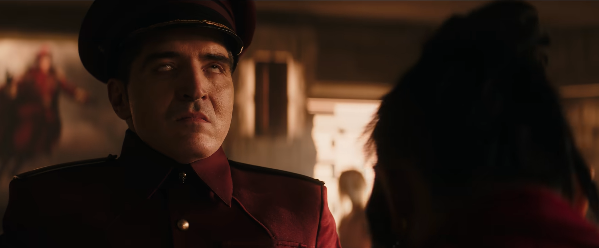
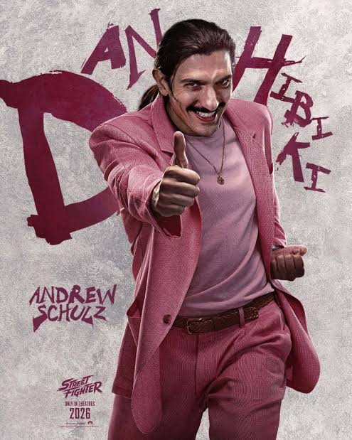
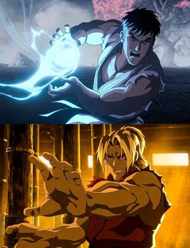

## DISCLAIMER 
Esse texto tá cheio de spoilers, de forma não ordenada e não especificada. Mas sinceramente? Spoilers nesse filme só importam se você nunca viu nada de Street Fighter, e se for esse o caso, você provavelmente namora com um fã de Street Fighter, e vai sair da sala de cinema sem nenhum interesse por ver mais da franquia. Então estejam avisados.

## O que aconteceu
Esse vai ser o primeiro post sobre um assunto que eu não nada entendo: cinema. mas dia 18 de outubro de 2026, eu fui assistir o live action de Street Fighter, e apesar de não ter achado completamente ruim, as partes que eu não gostei, eu ***não gostei mesmo***, daí quero ventilar um pouco sobre isso.

## O que Street Fighter 2026 é?
Essa já é uma pergunta estranha de responder, porque o filme tem partes da história contadas de maneiras diferentes, mas, de maneira geral, Street Fighter 2026 é um filme de ***comédia***, e não é comédia irônica, subversiva, nem nada disso. A comédia desse filme é galhofa nível 10 anos de idade, temperado com algumas cenas legais de artes marciais misturadas com os poderes dos jogos. Essa é a maior parte do filme, só que tem mais ou menos 20 a 30 minutos (não contei) de ***animação 2D de altíssima qualidade***, inclusive me lembrou bastante outra animação que saiu em 2026: [Avatar: The Last Airbender (2026)](https://www.imdb.com/title/tt18259538). Mas eu volto na parte animada do filme mais pra frente.

## A comédia pode ser perfeitamente descrita como "Cringe"
Também conhecida como vergonha alheia, Street Fighter tem muitas cenas que, quando vistas em um local público, com outras pessoas desconhecidas, me fizeram querer ir embora de tão dolorosamente embaraçosas. A maior parte desse sentimento se deu porque o padrão da sala de cinema era claro: muitos casais, sendo que uma pessoa deve ter lutado pra convencer a parceira que não sabe nem o que é um hadouken a ir assistir o filme, e a primeira impressão que ela ia ter da franquia, era o M. Bison cheirando o pé da Chun Li no meio do combate. Acho que referenciar a parte fetichista da comunidade no filme que serviria de introdução pra muitas pessoas não foi a melhor das ideias.

## O pacing do filme é tenebroso
Street fighter tem, segundo o site do Kinoplex, duas horas de duração, isso são 17 minutos a mais que [Street Fighter II: The Animated Movie](https://www.imdb.com/title/tt0114563). Inclusive, essa é minha recomendação pra porta de entrada a Street Fighter caso sua parceira não queira jogar os jogos, o filme é de 1994, talvez o fan service não tenha envelhecido graciosamente, mas vale a pena dar uma chance. Tangentes a parte, por que o pacing do live action não funciona tão bem quanto o pacing da animação?

Eu precisaria reassistir ambos pra ter certeza, mas creio que o problema do 2026 seja ***Sensory Overload***, também conhecido como: tem muita coisa acontecendo na tela, e as vezes nem são cores, é a velocida da troca das cenas. Um exemplo que me marcou bastante foi o primeiro encontro da Chun Li com o Ryu, que inclusive tá no [trailer](https://youtu.be/U6sbm1OaJb8?t=21). Vejam a velocidade que a Chun Li dá o tapa no Ryu depois dele terminar a frase. Geralmente, em trailers, eles cortam fillers pra contar uma história diferente do produto final, só que nesse caso eu ***garanto*** que a Chun Li deu esse chute nos mesmos frames no corte final. Isso dá a impressão que ela já sabia que o Ryu diria o que ele disse, mas a Chun Li, até esse ponto, nunca interagiu com o Ryu na vida dela. Agora imagina esse estilo de pacing em uma grande parte das cenas do filme, pois é.

## Alguns males vem para o bem - Dan Hibiki
É óbvio que Street Fighter não é um filme nota 0, em geral, a escolha do casting é boa, mesmo que as cenas que eles precisem fazer nem sempre acompanham a qualidade dos atores, só que tem um personagem que me surpreendeu positivamente, o Dan, que nesse filme, é o agente do Ken (que é uma celebridade). Pra quem não conhece, Dan Hibiki é o "joke character" da franquia Street Fighter, nos jogos, ele é o pior personagem de jogar, de propósito. Pra quem jogou o melhor jogo de luta de todos os tempos, também conhecido como Budokai Tenkaichi 3, deve lembrar do Mr. Satan, é exatamente a mesma vibe. Só que, curiosamente, as cenas mais equilibradas do filme geralmente são protagonizadas pelo Dan. Ele genuinamente se preocupa com o Ken quando as cenas são sóbrias, e consegue transmitir um humor que você não gargalha, mas sorri, numa vibe de "Eu tentei, mas sou azarado". Se for pra fazer mais Street Fighter de comédia, esse Dan seria um bom protagonista.

## A animação 2D é excelente, e isso me deixa bravo
Como eu disse, o filme abençoa o espectador com alguns minutos de animação, e o fato dela existir me incomoda bastante. Resumidamente, a animação serve pra mostrar o passado dos personagens. A final do primeiro torneio, onde o Ryu derrota Sagat, é completamente animada. O treino de Ryu e Ken, completamente animado. O embate entre Gouken e Akuma, completamente animado. E realmente tá tudo certo ali, não tem pacing de TikTok, não toca [4 Non Blondes](https://youtu.be/6NXnxTNIWkc?list=RD6NXnxTNIWkc), não tem Bison tarado, então por que me deixa bravo? O motivo é que eu descobri que aquela animação é o que eu queria pra um filme Street Fighter, na verdade, eu tenho uma hot take:

> Filmes de fantasia deveriam quase sempre ser animados, não filmados

Eu ainda quero escrever sobre isso, mas resumidamente, sempre que rolava as cenas animadas, eu pensava: *"Por que não fizeram ESSE filme?"*. Atacaria a nostalgia da galera mais velha da mesma forma, e se for pra gastar um dinheirão com o filme, já gasta animando de uma vez caramba, sério, olha esses frames!

## Conclusão
Eu poderia falar mais coisas que não gostei, tipo a Cammy e o excesso de personagens em uma trama curta demais pra isso, mas francamente tô com preguiça, e também não acompanho Street Fighter Desde o começo. Só comecei a jogar mesmo no 4, daí eu pulei o 5, e agora eu jogo Street Fighter 6. Mas no geral, Street Fighter 2026 foi um filme com conflito de ideias, e o sentimento que me passou foi que a equipe sabia exatamente o que seria o filme perfeito de Street Fighter (A parte animada), só que ainda assim resolveram insistir na galhofa pastelona nível *Sessão da Tarde*, isso me deixa triste, e ainda mais desesperançoso pro Live Action de [The Legend of Zelda](https://www.imdb.com/title/tt29873948/), mas esse é outro tópico. E nunca se sabe né? talvez os produtores de Street Fighter 2026 percebam que a melhor parte do filme ***não é*** o live action.